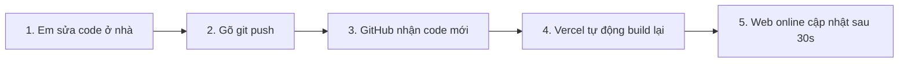

# Sổ Tay Công Nghệ Web Dành Cho Xuân Nhi 🍮
*Giải thích dễ hiểu từ A–Z: Mã nguồn, GitHub, Vercel Hosting, Tên miền (Domain) và Khi nào nên dùng Localhost vs Web*

---

## 1. Ẩn dụ "Mở Tiệm Bánh": 5 khái niệm cốt lõi

| Khái niệm | Ẩn dụ đời thực | Vai trò thực tế trong dự án của em |
| :--- | :--- | :--- |
| **Code trong máy** (`study-quiz-hub`) | **Công thức & Nguyên liệu trong bếp nhà** | Mã nguồn React, HTML, CSS nằm trong ổ cứng máy tính của em. Khi chạy `npm run dev`, chỉ máy tính của em mới thấy (`localhost`). Tắt máy là không ai vào được. |
| **GitHub** (`github.com/xuannhj/...`) | **Sổ tay công thức trong két sắt trên mây** | Nơi lưu trữ và bảo vệ mã nguồn. Máy tính ở nhà có hỏng hay em ra quán net thì toàn bộ code vẫn an toàn trên GitHub, không bao giờ bị mất. |
| **Vercel** *(Web Hosting)* | **Mặt bằng cửa tiệm mở cửa 24/7** | Máy chủ điện toán đám mây chạy ngày đêm trên mạng. Vercel tự động lấy code từ GitHub về, đóng gói (build) thành web thật và mở cửa sẵn. Dù em tắt máy tính đi ngủ, người khác trên toàn thế giới vẫn vào web làm bài được. |
| **Tên miền (Domain)** (`xuannhj.tech`) | **Biển hiệu mặt tiền xịn xò** | Thay vì bắt bạn bè phải nhớ cái link dài loằng ngoằng (`study-quiz-hub-plum.vercel.app`), tên miền giống như biển hiệu thương hiệu cá nhân, đẹp mắt và dễ nhớ. |
| **DNS** *(Bản ghi A, CNAME)* | **Bác bảo vệ chỉ đường** | Tên miền chỉ là chữ cái. DNS là cuốn sổ địa chỉ chỉ dẫn: *"Ai gõ study.xuannhj.tech thì hãy dắt họ đến đúng máy chủ Vercel!"*. |

---

## 2. Quy trình "Thần kỳ" khi em cập nhật web (CI/CD)

Mỗi lần em muốn thêm câu hỏi mới hoặc chỉnh sửa giao diện:

Em **không cần** phải tải file lên hosting thủ công, mọi thứ đã được tự động hóa hoàn toàn!

---

## 3. Subdomain là gì? 1 tên miền làm được bao nhiêu dự án?

- Tên miền chính của em: **`xuannhj.tech`** (giống như tên công ty/thương hiệu).
- **Subdomain (Tên miền phụ)**: Thêm một tiền tố ở phía trước, **hoàn toàn miễn phí và tạo bao nhiêu cũng được**:
  - 📚 **`study.xuannhj.tech`**: Dự án Web ôn thi trắc nghiệm này.
  - 💻 **`xuannhj.tech`** *(hoặc `portfolio.xuannhj.tech`)*: Sau này em làm trang giới thiệu bản thân / CV cá nhân để đi xin việc.
  - 🛒 **`shop.xuannhj.tech`**: Dự án làm web bán hàng thương mại điện tử.
  - 💬 **`chat.xuannhj.tech`**: Dự án làm ứng dụng nhắn tin thời gian thực.

---

## 4. Bây giờ em nên dùng Localhost hay dùng Web Online?

Tùy vào việc em đang muốn làm gì nhé:

### Trường hợp 1: Khi em muốn HỌC BÀI, LUYỆN ĐỀ, ÔN THI 👉 **DÙNG WEB ONLINE**
- **Đường link:** `https://study.xuannhj.tech` *(hoặc `https://study-quiz-hub-plum.vercel.app`)*
- **Ưu điểm:**
  - Không cần bật VS Code, không cần gõ lệnh `npm run dev` chi cho nặng máy.
  - Mở được trên điện thoại, iPad, laptop ở nhà hay máy tính ngoài quán net.
  - Tốc độ tải cực nhanh vì đã được Vercel tối ưu sẵn.

### Trường hợp 2: Khi em muốn SỬA CODE, THÊM CÂU HỎI MỚI 👉 **DÙNG LOCALHOST**
- Em mở VS Code ở nhà, gõ `npm run dev` để chạy trên máy (`localhost:5173`).
- Vừa gõ code vừa nhìn thấy kết quả thay đổi tức thì trên màn hình để kiểm tra xem có lỗi không.
- Khi nào sửa xong và kiểm tra ưng ý rồi thì chỉ cần `git push` một phát là bản mới sẽ tự động bay lên Web Online cho em!
